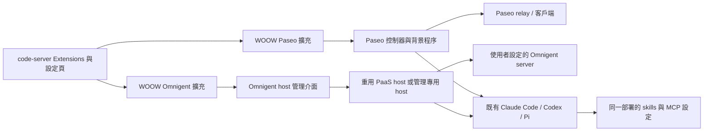

# code-server 的 Paseo／Omnigent 擴充研究

日期：2026-11-10。分支：`feat/paseo-omnigent-extensions`。
基底：`41d01bd31b7c2bcd481132d3f1af36a2ea42633d`。
狀態：2026-11-10 使用者已指示團隊接續實作、安裝部署與三平台真實連線測試。下列來源研究為設計基線，實際完成情形以後續驗收紀錄為準。

## 目標與目前假設

製作兩個可在 code-server Extensions 頁面找到、查看版本並進入設定的 VS Code 擴充：

- **WOOW Paseo**：管理這個 code-server 環境中的 Paseo daemon，顯示配對入口、代理與連線狀態。
- **WOOW Omnigent**：設定 Omnigent server 並登入，把這個 code-server 註冊為可執行代理的 host。

目前以「讓遠端 Paseo／Omnigent 使用 code-server 內的 Claude Code、Codex、Pi」作為第一版設計假設。若需求是從 code-server 操作別台 host，需增加遠端 host／session 瀏覽與聊天客戶端，屬於另一組功能。這份文件沒有把該假設當作使用者已答覆。

使用者已確認接續完整實作，直到可安裝部署並從 Paseo Web／Omnigent 在 PaaS、Podman、HA add-on 操作三代理與切換模型。以可安裝 VSIX 及三平台預裝為本輪交付；Open VSX 公開上架不作為安裝與驗收的前提。

## 已查到的來源

來源版本是此次讀取的快照，不代表所有正式部署均已使用該版本。完整 commit 與主要檔案 SHA-256 見 [來源紀錄](../research/code-server-connectors-sources.json)。

| 來源 | 快照版本／commit | 實際整合方式 | 可沿用的部分／需替換的部分 |
| --- | --- | --- | --- |
| [Pi Paseo](https://github.com/WOOWTECH/pi-paseo-plugin/tree/2d5531fd65f80a58a15ed19c709a4f29e52d3723) | 外掛 0.1.15；Paseo 0.11.2 | Pi Settings、`host-api.mjs`、daemon supervisor | 可參考配對、程序歸屬、鎖與停止狀態；必須替換 Pi 套件管理器綁定 |
| [Pi Omnigent](https://github.com/WOOWTECH/pi-omnigent-plugin/tree/3243b231c9862f36d480c5144775f585c1305207) | 外掛 0.3.31；預設 SDK 0.16.0 | Pi Settings、Node 控制器、Python adapter | 可參考部署既有 host 的重用、登入與驗證紀錄；替換 Pi UI／套件生命週期 |
| [Hermes Paseo](https://github.com/WOOWTECH/hermes-paseo-plugin/tree/1101a5da63178e08bd0fdf849db8e2a5de4d6ef1) | 0.1.4-rc.9 | Hermes Dashboard manifest、Python API、Node runtime | 可參考背景恢復、手動停止與配對保護；Dashboard manifest 不是 VSIX |
| [Hermes Omnigent](https://github.com/WOOWTECH/hermes-omnigent-plugin/tree/5df9acd3c1b676428d1a949aa33a982356639526) | 0.1.0-rc.20；SDK 0.20.0 | Hermes 原生插件與私有 Python runtime | 可參考模型實測、私有依賴、生命週期；不能假定 SDK 0.20 與既有 0.16 可直接互換 |
| [OD Paseo](https://github.com/WOOWTECH/opendesign-paseo-plugin/tree/3b86730b1e3c9c72cb1f5d6f567502aae37a26df) | 0.2.3 | OD 原生 launcher、受登入保護的設定頁、背景 runtime | 可參考預先建置 runtime、管理 API、MCP 原子更新；OD proxy／onboarding 要換成 VS Code 介面 |
| [OD Omnigent](https://github.com/WOOWTECH/opendesign-omnigent/tree/6ebc63aacc582251b8bebe42b51d3056ff3374d2) | OD 分支 0.23.1；SDK 0.16.0＋固定 patch | OD 核心 daemon 的 native service／host kit | 可參考登入隔離、復原與 SDK 相容性檢查；這是核心整合，不是可直接安裝的通用外掛 |

OD Omnigent 的根授權為 Apache-2.0；其他五個參考套件根授權為 MIT。若抽取實作，保留對應授權、來源 commit 與修改紀錄，另確認所抽取檔案的第三方聲明。

### 不能直接包一層介面的原因

1. **Pi 版本與生命週期綁定。** 本基底 Pi 是 0.99.1；兩個 Pi 外掛目前要求 Pi 1.x。Paseo 的 `host-api.mjs` 會 import `supervisor.mjs`，後者直接載入 Pi 的 `SettingsManager` 與 `DefaultPackageManager`。因此連 `host-api` 也不是完全獨立的 runtime API。參考來源：[Paseo supervisor](https://github.com/WOOWTECH/pi-paseo-plugin/blob/2d5531fd65f80a58a15ed19c709a4f29e52d3723/src/supervisor.mjs)、[Omnigent manifest](https://github.com/WOOWTECH/pi-omnigent-plugin/blob/3243b231c9862f36d480c5144775f585c1305207/package.json)。
2. **安裝可能有副作用。** Pi 外掛有 postinstall／自動 activate。不能把安裝來源套件當作只下載函式庫，更不能因此自動改裝 Pi Web 或啟動第二個 host。
3. **SDK 與 patch 不同。** Pi、OD、PaaS 的 Omnigent 0.16 路徑各有相容性處理；Hermes 已用 0.20。初版以現有 PaaS 0.16 相容路徑為候選，不把跨版升級混在 UI 接入內；正式 pin 必須由三代理測試確定。
4. **三個宿主的擴充格式不同。** Pi extension、Hermes Dashboard manifest、OD launcher 都不會自動成為 VS Code Extensions 卡片。
5. **登入成功、host 在線、模型成功回覆是不同狀態。** 既有插件可提供驗證設計，但其測試紀錄不能代替 code-server 新擴充的驗收。

## 建議架構

依 VS Code 官方定義，需呼叫容器內 CLI 的邏輯應在 Node extension host 執行；候選 manifest 使用 `main` 與 `extensionKind: ["workspace"]`。UI 以原生設定、命令、狀態檢視和小型 Webview 提供。[Extension Host 文件](https://code.visualstudio.com/api/advanced-topics/extension-host)

圖中箭頭表達控制關係。Omnigent host 主動向 server 建立連線；Paseo daemon 使用配對與 relay。第一版不需要新增對外開放的管理埠。

建議原始碼分為 `extensions/paseo`、`extensions/omnigent`、共同的 connector 控制介面與各自 runtime adapter。兩個 VSIX 各有獨立 ID、版本、設定與停用入口；不依賴私有 VS Code API，也不修改 code-server 核心 JavaScript。

runtime 由映像建置時預先備妥並固定版本／lock／patch hash；VSIX 負責操作與診斷。這樣三種部署可以使用同一組擴充與 runtime。一般 code-server 手動安裝 VSIX 時，若缺少 runtime，需顯示可執行的安裝／修復流程；不能顯示「已連線」。是否把 runtime 安裝器納入第一版，取決於是否要支援公開上架後的任意 code-server。

### Extensions 頁面與操作流程

暫定 ID 為 `woowtech.paseo`、`woowtech.omnigent`；尚未確認 Open VSX namespace 所有權，不能視為已保留名稱。

每個擴充至少包含：display name、圖示、版本、README、設定入口、連線狀態、操作命令及診斷輸出。manifest 的 `contributes` 宣告設定、命令與 view。[Extension Manifest 文件](https://code.visualstudio.com/api/references/extension-manifest)

| 使用者操作 | Paseo | Omnigent |
| --- | --- | --- |
| 開啟設定 | 工作目錄、顯示名稱、背景連線選項 | Server URL、工作目錄、host 名稱、管理模式 |
| 首次連線 | 啟動 daemon，再產生短效配對入口 | 輸入帳號與遮罩密碼，登入後註冊／重用 host |
| 配對／登入完成 | 顯示 daemon、relay／客戶端連線狀態 | 顯示 server、host 與實際連線狀態 |
| 代理檢查 | 分列 Claude、Codex、Pi 的安裝／登入／模型狀態 | 同左 |
| 驗證 | 使用所選模型執行真實對話，保留驗證時間與結果 | 同左；驗證紀錄綁定 server、host、CLI 版本 |
| 停止／斷線 | 記住停止狀態，重啟不自行恢復 | 自管 host 停止並撤除本連線授權；部署管理模式需走對應管理介面 |

**預裝可見與商城可搜尋是兩項交付。** 官方支援從命令面板 Install from VSIX，或用 `code-server --install-extension <file.vsix>` 安裝。code-server 的預設來源為 Open VSX；只產生 GitHub Release 的 VSIX 不會自動上架。[code-server FAQ](https://coder.com/docs/code-server/FAQ#how-do-i-install-an-extension-manually)

現有映像將固定版本 ACP／Claude 擴充放在 `/usr/lib/code-server/lib/vscode/extensions`，使用者擴充另存持久卷。新擴充若沿用內建方式，Extensions 的分類、`@builtin`／`@installed` 可見性，以及停用操作必須用瀏覽器驗證；不要只靠 `--list-extensions` 判定 UI 已符合需求。若要像一般擴充可卸載，改採使用者擴充卷的首次安裝與明確升級紀錄，且尊重使用者卸載，不在每次開機強制裝回。

### 設定、登入與程序生命週期

- Server、runtime 路徑與註冊工作目錄由部署／使用者層管理。不能讓開啟的 repository 自行覆寫連線目標、憑證路徑或可執行檔。
- 密碼只交給本次登入；不放在 `settings.json`、命令列參數、診斷或聊天訊息。SDK token 留在該部署的私有儲存；若用 VS Code SecretStorage，必須先驗證 code-server 實際後端與重建持久性，不能由 API 文件推論容器上已有可用金鑰庫。[SecretStorage 文件](https://code.visualstudio.com/api/references/vscode-api#SecretStorage)
- Webview 透過已驗證的 message schema 呼叫 extension，再呼叫固定 adapter。限制 CSP、檢查動作與輸入，使用參數陣列啟動程序；配對連結不進日誌或持久 UI state。[Webview 文件](https://code.visualstudio.com/api/extension-guides/webview#security)
- 同一 code-server 開兩個瀏覽器或不同 workspace，仍只管理一份同服務 daemon。鎖與程序紀錄需包含 UID、PID、程序開始時間／boot identity、所屬 state root。
- 背景連線由容器內管理程序維持。瀏覽器關閉與 Reload Window 不能直接等同於斷線；extension 的 `deactivate()` 只釋放 UI／client 資源。
- 第一版需明確區分「擴充介面停用」與「停止背景連線」。若要求 Extensions 的 Disable／Uninstall 必須立即停止 daemon，還需驗證 code-server 可用的管理事件與背景協調機制；不能假設公共 deactivate API 可分辨停用、瀏覽器斷線與 extension host 重啟。
- 自動恢復只能恢復本部署已確認的連線；手動停止、登出、改 server 必須使舊驗證失效。不要因設定頁開啟就建立測試聊天。

## 三種部署如何接入

| 部署 | 此次來源看到的狀態 | 實作落點 |
| --- | --- | --- |
| Podman | 三代理、共用工具與持久卷已在基底；尚無 Paseo／Omnigent connector runtime | Containerfile 打包 runtime／VSIX；在既有啟動與關閉流程加入受管理背景程序；沿用 deployment-private volume |
| HA add-on | 三代理基底；未找到這兩個 connector 的打包 | 使用相同 VSIX／runtime，接入 s6；從真正 HA Ingress 驗證設定頁、配對連結與重啟 |
| PaaS／k3s | 映像已有 Omnigent 0.16.0；chart 預設 `omnigentHost.enabled: true` | 優先偵測並重用 chart host；增加 UI adapter，不同時另起 private host；Paseo 加入同一容器的管理程序 |

PaaS 的 `OG_SERVER_URL`／runtime ConfigMap 是提示／fallback；實際登入的 server 才是既有 host 的連線目標。顯示狀態不能只讀 chart 提示。背景 kit 已有固定 CLI、PID 鎖、watchdog、退避與記憶體保護，接入應保留這些能力。

Omnigent 控制介面建議有兩種明確模式：

- **deployment-managed**：讀取 kit 狀態，使用同一 SDK／private home 完成登入；交由 kit 連線。找不到可用 stop／pause 管理介面時，先補 kit 合約，不能以殺程序模擬永久停止，因為 supervisor 會重啟它。
- **connector-managed**：在沒有既有 host 管理程序時，由專用 supervisor 管理一份 host。

來源中的 OD 原生 Omnigent 採用「停掉舊 chart supervisor，再交給原生 service」的方案；code-server 不應在尚未完成遷移設計時直接照搬。若未來改成單一新管理器，要一併測試舊 host ID、server、對話連結、登入、停機切換與回滾。

## 三代理的 skills／MCP 共用

本基底已有 [agent-sync](../../rootfs/opt/woow-agent-tools/agent-sync.mjs)，應沿用：

| 內容 | 權威來源／映射 |
| --- | --- |
| Skills | `/data/pi-agent/skills`；Claude、Codex 與 Pi 的對應搜尋路徑連回此處 |
| MCP registry | `/data/pi-agent/shared/mcp.json` |
| Pi | `PI_CODING_AGENT_DIR=/data/pi-agent`；產生該目錄下的 MCP 設定 |
| Claude | `CLAUDE_CONFIG_DIR=/data/pi-agent/claude` |
| Codex | `CODEX_HOME=/data/pi-agent/codex` |

這裡「共用」指同一個 code-server 部署中的三代理，不會把其他 OD／Hermes／Pi 部署的登入卷接進來。模型供應商登入與 MCP OAuth 仍依各工具原生機制管理。

connector 啟動代理時要傳遞相同的有效環境與設定。Omnigent native session 可能建立 session 專屬 home；必須檢查實際產生的 config／skills 路徑，不能只因父程序有 `CODEX_HOME` 就宣布共用成功。Paseo provider launcher 同樣要驗證，不能額外安裝另一套 CLI 後接到空的 home。

更新共用 MCP 後沿用同步工具，診斷只顯示名稱／設定摘要；如需代理重啟才生效，UI 明示並重建測試 session。不得從模型回覆文字推論它真的呼叫工具；驗收需有工具端的執行紀錄。

## 實作順序與可驗收成果

1. **相容性與管理合約。** 固定 Paseo／Omnigent runtime 候選；在隔離容器驗證 Pi 0.99.1、Claude 2.1.285、Codex 0.167.0 的啟動與 catalog。抽掉 Pi package-manager 綁定，定義 status／connect／disconnect／pair／verify，處理 PaaS 單一 host 所有權。
2. **兩個 VSIX 與真實 UI。** 建立 manifest、設定與命令、診斷和連線頁；在 code-server 安裝，從 Extensions 開啟兩個擴充。先驗證空白環境與缺少 runtime 的錯誤路徑。
3. **背景程序與重啟。** runtime 預先打包、持久 state、單一程序鎖、多視窗、停止狀態、重建恢復與升級／回滾。
4. **真實連線與工具。** 使用者完成所需登入／配對後，兩個 connector 各測三代理的對話、模型切換、skills 與 MCP。
5. **三平台對齊。** Podman、HA Ingress、PaaS 各驗證；用同一份測試矩陣和 artifact hash。完成後才有「已實作實測」的證據。
6. **發佈。** 產出兩個 VSIX、checksum、runtime manifest 與相容性說明；部署 repo 使用固定 artifact。若需要商城搜尋，再使用有權限的 Open VSX namespace 發佈。

### 必須保留的驗收紀錄

| 類別 | 通過條件 |
| --- | --- |
| Extensions 可見性 | 兩張卡片、正確 ID／版本、設定入口；瀏覽器實際點擊可操作 |
| 首次設定 | 空卷顯示未設定；安裝／開頁不自動建立遠端連線或聊天 |
| Omnigent | GUI 登入後 server 上出現正確 host；實際 workspace 與 engine inventory 正確 |
| Paseo | 產生配對入口，客戶端完成配對後可對此 daemon 建立 session；relay 狀態不靠 process 存活推論 |
| 三代理對話 | 每個 connector 的 Claude／Codex／Pi 都產生 assistant 回覆，至少兩輪；區分 user echo 與 assistant output |
| 模型切換 | 同一代理 session 切換到另一個已授權模型後再回覆，記錄有效模型；只有一個可用模型時標示尚未驗證 |
| 代理切換 | 三代理各可選用。若服務切換代理會另建 session，UI 與報告明示，不能宣稱上下文已無縫承接 |
| Skills | 三代理讀到同一測試 skill，依 skill 指示完成可觀察操作，並留下執行證據 |
| MCP | 三代理對同一 fixture MCP 真正調用工具，核對工具端記錄；加入／更新／移除後無殘留設定 |
| PaaS 既有 host | 無第二份 host／supervisor；錯誤 server 提示不覆寫既有登入；停止狀態不被 watchdog 反覆撤銷 |
| 持久性 | 關閉瀏覽器、Reload Window、容器／pod 重建後符合背景連線設定；手動停止保持停止 |
| 併發與錯誤 | 雙視窗同時設定、斷網重連、runtime 缺少、登入失效與模型額度不足都呈現可辨識狀態 |
| 部署邊界 | 真正 HA Ingress、PaaS 路由及 Podman HTTPS 入口可操作；amd64／arm64 runtime 分別驗證 |
| 私有資料 | diagnostics／VSIX／Git 不含密碼、token 或配對憑證；state 使用私有權限 |
| 升級與回滾 | artifact 固定版本；停用／卸載語義與使用者設定被尊重；不遺失登入、不重複 daemon |

## 本輪結論與尚未證實的事項

可行方向已確定：兩個 VS Code 擴充加上可獨立於瀏覽器運作的 connector runtime，沿用 code-server 的三代理與共用工具配置。最需先解決的是 Pi 套件管理器耦合、Omnigent SDK 差異、PaaS 既有 host 管理，以及 Extensions 停用與背景程序生命週期的語義。

本輪完成的是來源比對、架構與驗收設計。尚未產生／安裝新的 VSIX，未使用這兩個新擴充登入、配對或進行模型測試，也未發佈至 Open VSX。既有 code-server 三代理／ACP 的成功測試不等於新 connector 通過。
